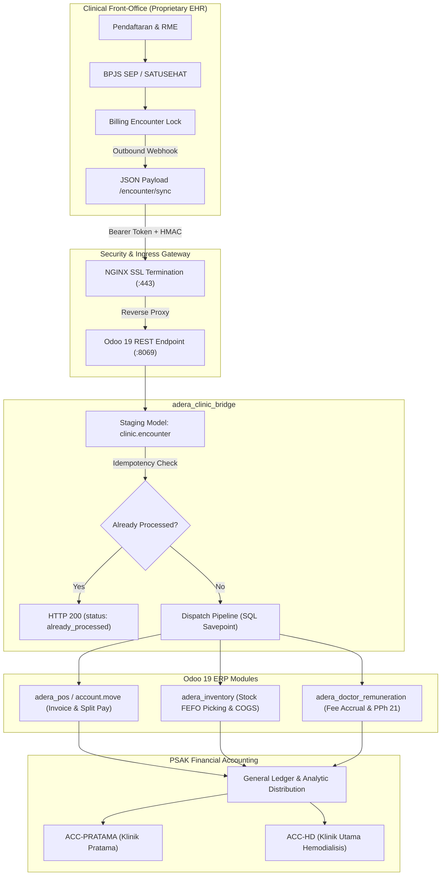
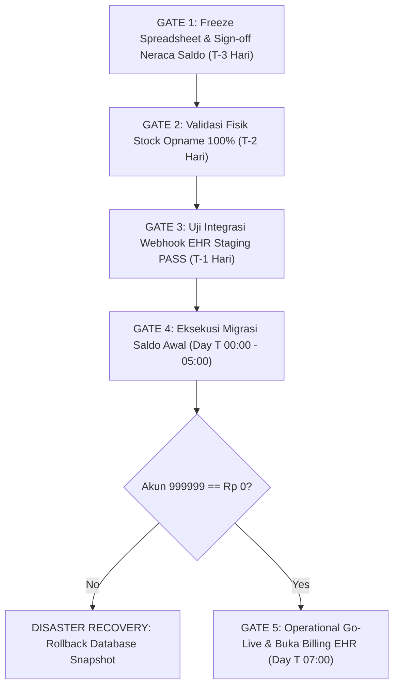

# ENTERPRISE PRODUCT REQUIREMENT DOCUMENT (PRD) & PROJECT RISK MANAGEMENT FRAMEWORK
## Klinik ADERA ERP Digital Transformation — Odoo 19 Community Edition
**Document Tracking ID:** `PRD-ADERA-ERP-19-V3.0-FINAL`  
**Author:** Principal Healthcare ERP Solutions Architect & Enterprise Risk Lead  
**Entity:** PT Prosperra Medika Utama / Klinik ADERA (Klinik Pratama Rawat Jalan & Klinik Utama Hemodialisis)  
**System Baseline:** Odoo 19.0 CE on Hardened Linux/Docker Stack (PostgreSQL 15, Python 3.12, NGINX SSL Proxy)

---

## 1. ULTRA-DETAILED PRODUCT REQUIREMENT DOCUMENT (PRD)

### 1.1 Architecture & Baseline System Topology
Klinik ADERA menerapkan **Decoupled Architecture Boundary** antara sistem rekam medis klinis (*front-office*) dan sistem operasional akuntansi (*back-office*):
- **Clinical Front-Office (Proprietary EHR/EMR):** Menangani proses registrasi pasien, antrean poli, rekam medis elektronik (RME) berstandar Kemenkes, bridging SATUSEHAT via FHIR API, penerbitan Surat Elegibilitas Peserta (SEP) BPJS Kesehatan, dan penguncian tagihan medis (*billing lock*).
- **Financial & Operational Core (Odoo 19 Community Edition):** Bertindak sebagai *System of Record* untuk akuntansi akrual berpasangan (*double-entry GAAP/PSAK*), valuasi persediaan *perpetual FIFO* dengan aturan *FEFO*, kasir POS terintegrasi kas/piutang klaim BPJS, perhitungan progresif PPh 21 Tenaga Ahli Dokter, dan pengadaan barang (*3-way matching*).
- **Inter-System Communication:** Protokol asinkron *push webhook* HTTP/REST berbasis JSON (`/api/v1/clinic/encounter/sync`) dengan autentikasi *Bearer / API Key*, *idempotency lock* pada `external_encounter_id`, dan *staging transaction queue*.



---

### 1.2 Functional & Technical Specifications per Custom Module

#### 1.2.1 `adera_core` — Foundation, PSAK CoA, Clearing Accounts & Analytic Engine
* **Tujuan Arsitektur:** Menyediakan bagan akun berstandar PSAK Indonesia, rekening penampung transaksi menggantung (*interim clearing accounts*), buku jurnal operasional klinik, rencana distribusi biaya multi-unit (*Analytic Distribution*), dan antarmuka *Enterprise App Switcher*.
* **Bagan Akun PSAK Spesifik Klinik (CoA `111010` - `619990`):**
  - `111010` Kas Induk Operasional Klinik (Asset/Liquidity)
  - `111210` Kas Kecil Kasir (Petty Cash/Kasir Front-Office)
  - `111220` Bank Rekening Operasional (BCA/Mandiri/QRIS Settlement)
  - `112010` Piutang Pasien Umum / Piutang Usaha (Receivable)
  - `112020` Piutang Klaim BPJS Kesehatan (VClaim / SEP) (Receivable / Non-Trade)
  - `112990` Cadangan Kerugian Penolakan / Dispute Klaim BPJS (Contra-Asset)
  - `113010` Persediaan Obat & Alkes Farmasi (Current Asset / FIFO Stock)
  - `113020` Persediaan Consumable & Cairan Hemodialisis (Current Asset / FIFO Stock)
  - `211010` Utang Usaha / Hutang Distributor Farmasi (Payable)
  - `211500` Utang Belum Ditagih / GR/IR Interim Clearing (Current Liability)
  - `212030` Utang Pajak PPh 21 Tenaga Ahli Dokter (Current Liability)
  - `213010` Utang Akrual Jasa Medis Dokter Rawat Jalan (Current Liability)
  - `213020` Utang Akrual Jasa Medis Dokter Hemodialisis (Current Liability)
  - `214010` Pendapatan Diterima di Muka - Paket Terapi HD (Deferred Revenue)
  - `410010` Pendapatan Jasa Konsultasi & Rawat Jalan (Operating Revenue)
  - `410020` Pendapatan Tindakan Prosedur Medis Hemodialisis (Operating Revenue)
  - `410030` Pendapatan Penjualan Obat & BHP Farmasi (Operating Revenue)
  - `510010` Beban Pokok Pendapatan (COGS) Obat & BHP (Expense / Direct Cost)
  - `510020` Beban Pokok Pendapatan (COGS) Consumable Dialyzer & Cairan HD (Expense / Direct Cost)
  - `510110` Beban Jasa Medis Dokter Rawat Jalan (Expense)
  - `510120` Beban Jasa Medis Dokter Spesialis Penanggung Jawab HD (Expense)
  - `619990` Beban Selisih Rekonsiliasi Kas Kasir / Blind Count Variance (Operating Expense)
  - `999999` Akun Perantara Saldo Awal Migrasi / Opening Balance Suspense (Current Asset/Clearing)
* **Jurnal Operasional Klinik:**
  - `INVOUT` Jurnal Penjualan Kasir / Tagihan Pasien
  - `BMED` Jurnal Pembelian Faktur PBF / Distributor Farmasi
  - `STJ` Jurnal Penyesuaian & Pemotongan Persediaan (Stock Valuation)
  - `JMED` Jurnal Jasa Medis & Remunerasi Dokter
  - `POS` Jurnal Transaksi Kasir Point of Sale
* **Analytic Distribution Multi-Unit:**
  - Analytic Plan: `Adera Business Units`
  - Analytic Account 1: `ACC-PRATAMA` (Klinik Pratama Rawat Jalan).
  - Analytic Account 2: `ACC-HD` (Klinik Utama Hemodialisis).
  - Setiap faktur tagihan dan kartu persediaan otomatis di-tagging ke unit terkait untuk menghasilkan Laporan Laba/Rugi (*P&L*) terpisah tanpa memecah GL.

---

#### 1.2.2 `adera_inventory` — Perpetual FIFO Valuation, Mandatory Lot/Exp & FEFO Guardrail
* **Anglo-Saxon Perpetual FIFO:** 
  - Kategori Produk Farmasi (`CAT-OBAT`) dan Consumable HD (`CAT-HD`) dikonfigurasi dengan `property_cost_method = 'fifo'` dan `property_valuation = 'real_time'`.
  - Saat barang diterima dari PBF (Goods Receipt / GRN), Odoo secara otomatis mendebit Persediaan (`113010`/`113020`) dan mengkredit Utang Belum Ditagih (`211500`).
* **Mandatory Lot & Expiry Enforcement:**
  - Seluruh produk farmasi bertipe *storable* (`is_storable = True`) memiliki konfigurasi *tracking by lot* (`tracking = 'lot'`).
  - Model `stock.picking` di-patch dengan validasi ketat (*strict guardrail*): Pada saat tombol *Validate* ditekan, sistem menolak jika ada baris pergerakan stok yang tidak memiliki `lot_id` atau atribut `expiration_date` bernilai null / masa kadaluarsanya kurang dari hari validasi.
* **FEFO Removal Strategy:**
  - Dikonfigurasi menggunakan `product_expiry.removal_fefo` pada lokasi stok internal klinik (`WH/Stock/Farmasi` dan `WH/Stock/DepoHD`).
  - Saat resep pasien atau tindakan HD dijalankan, Odoo secara otomatis memilih nomor lot dengan tanggal kedaluwarsa paling awal (*First Expired, First Out*).
* **Expiry Quarantine Isolation (`WH/Quarantine`):**
  - Disediakan lokasi stok khusus non-operational (`usage = 'internal'`, ditandai karantina).
  - Skrip terjadwal otomatis merekomendasikan pemindahan produk yang masa kedaluwarsanya di bawah 60 hari ke lokasi karantina agar tidak terpilih oleh mesin kasir.
* **3-Way Match AP Clearing:**
  - Faktur pembelian dari PBF (`account.move` tipe `in_invoice`) mencocokkan harga satuan pada Purchase Order (PO), kuantitas fisik pada GRN (`stock.picking`), dan dokumen tagihan PBF.
  - Saat dibukukan, faktur mendebit akun `211500` (GR/IR) dan mengkredit Utang Usaha `211010`, memastikan saldo rekening `211500` kembali ke **Rp 0.00**.

---

#### 1.2.3 `adera_pos` — Clinical Point of Sale, Blind Count & Multi-Tender Split
* **Cashier Shift Blind-Count Protocol:**
  - Kasir tidak diizinkan melihat saldo akhir teoritis yang dicatat oleh sistem saat sesi operasional berakhir.
  - Pada penutupan sesi (`pos.session`), kasir wajib memasukkan jumlah uang fisik hasil penghitungan riil di laci (*blind-count input*).
  - Sistem menghitung varians: `Selisih = Uang Fisik - Saldo Teoritis`.
  - Jika terjadi selisih, wizard penutupan kasir memvalidasi dan secara otomatis memposting jurnal penyesuaian selisih kas ke akun **`619990` (Beban Selisih Rekonsiliasi Kas Kasir)** dengan tagging analitik unit terkait.
* **Multi-Tender Split Payment (Pasien Umum vs BPJS):**
  - Mendukung metode pembayaran multi-jalur dalam satu transaksi layanan:
    1. Tunai / Cash (`pos.payment.method` tipe Kasir).
    2. QRIS / Debit EDC (Akun kliring bank `111220`).
    3. Piutang Klaim BPJS Kesehatan (Akun `112020` Piutang Klaim SEP).
  - Kasir dapat membebankan bagian *co-payment* ke pasien (misal tindakan tambahan atau selisih plafon Rp 50.000) dan sisanya (Rp 150.000) dibukukan langsung ke piutang klaim BPJS tanpa menunggu verifikasi BPJS selesai.
* **Hemodialysis Prepaid Package Liability Engine (PSAK 72):**
  - Modul mendukung produk voucher hemodialisis paket (`VOUCHER-PAKET-HD`, misal paket 4x hemodialisis).
  - Saat pasien membeli paket di muka, kasir membukukan uang masuk ke Kas dan mengkredit akun **`214010` (Pendapatan Diterima di Muka - Paket Terapi HD)**.
  - Setiap kali pasien datang melakukan tindakan cuci darah, sistem menerbitkan faktur pemotongan deposit sebesar 1/4 nilai paket yang mendebit `214010` dan mengkredit Pendapatan Tindakan HD `410020`.

---

#### 1.2.4 `adera_doctor_remuneration` — Medical Fee Split & Progressive PPh 21 Engine
* **Clinical Fee Split Rules (`medical.fee.rule`):**
  - Konfigurasi aturan bagi hasil berdasarkan dokter, spesialisasi, dan kode tindakan.
  - Mendukung persentase bagi hasil (misal: 60% Dokter, 40% Klinik) atau tarif nominal tetap (*fixed fee per encounter*).
* **Encounter Service Line Accrual:**
  - Saat tindakan medis diselesaikan di kasir atau diterima dari webhook EHR, sistem secara otomatis membentuk baris akrual jasa medis (`medical.fee.accrual`).
  - Menghasilkan jurnal akrual otomatis:
    - **Dr.** Beban Jasa Medis Dokter (`510110` / `510120`)
    - **Cr.** Utang Akrual Jasa Medis Dokter (`213010` / `213020`)
* **Progressive PPh 21 Calculation Engine (PMK 168/2023 & UU HPP):**
  - Tenaga medis dokter diklasifikasikan sebagai **Bukan Pegawai / Tenaga Ahli**.
  - **Dasar Pengenaan Pajak (DPP):** `50% x Penghasilan Bruto Tindakan`.
  - **Lapisan Tarif Pajak Progresif Pasal 17:**
    - Lapisan 1: Rp 0 s.d. Rp 60.000.000 -> **5%**
    - Lapisan 2: > Rp 60.000.000 s.d. Rp 250.000.000 -> **15%**
    - Lapisan 3: > Rp 250.000.000 s.d. Rp 500.000.000 -> **25%**
    - Lapisan 4: > Rp 500.000.000 s.d. Rp 5.000.000.000 -> **30%**
    - Lapisan 5: > Rp 5.000.000.000 -> **35%**
  - **Surcharge Non-NPWP:** Jika dokter tidak memiliki NPWP terdaftar pada partner, tarif pajak dinaikkan sebesar 120% (faktor 1,2x).
  - Sistem menyimpan nilai kumulatif penghasilan bruto tahun berjalan per dokter agar perpindahan bracket tarif berjalan presisi.
* **Doctor Settlement Batch & QWeb Bukti Potong:**
  - Fitur rekapitulasi pembayaran bulanan (`doctor.settlement`): Menggabungkan seluruh akrual dokter dalam satu periode, menghitung potongan PPh 21, dan memposting pembayaran ke Bank (`111220`) serta Utang Pajak PPh 21 (`212030`).
  - Menghasilkan cetakan resmi QWeb PDF: **Slip Bukti Potong Jasa Medis Dokter** lengkap dengan rincian nama pasien, tanggal encounter, nilai bruto, DPP 50%, tarif pasal 17, dan nilai bersih transfer dokter.

---

#### 1.2.5 `adera_clinic_bridge` — REST API Inbound Webhook & Idempotent Staging
* **Endpoint & Protokol Komunikasi:**
  - URL: `POST /api/v1/clinic/encounter/sync`
  - Port Produksi: 443 (HTTPS via NGINX) -> Internal Odoo 8069/8070.
  - Keamanan: Header `X-ADERA-API-KEY` atau `Authorization: Bearer <token>`.
* **Database Staging State Machine:**
  - Model: `clinic.encounter` & `clinic.encounter.line`
  - Siklus Status:
    ```
    [draft] -> [received] -> [staged] -> [posted]
                                │
                                └──> [error] (Savepoint Rollback)
    ```
* **Idempotency Guarantee:**
  - Sistem memvalidasi parameter unik `external_encounter_id`.
  - Jika ID telah berstatus `posted`, Odoo langsung merespons dengan `HTTP 200 { "status": "already_processed", "odoo_invoice_id": X }` tanpa membuat dokumen baru ataupun memotong stok ulang.
* **Atomic Transaction Execution:**
  - Seluruh proses pembuatan faktur pelanggan, pemotongan stok FEFO farmasi, dan akrual jasa medis dibungkus dalam satu blok transaksi database PostgreSQL (*atomic savepoint*).
  - Jika salah satu proses gagal (misal: stok lot tidak cukup atau konfigurasi akun dokter belum ada), seluruh mutasi di-rollback secara otomatis dan pesan kesalahan dicatat pada kolom `error_log`.

---

### 1.3 Data Architecture & API Contract Specification

#### JSON Payload Schema Contract (`POST /api/v1/clinic/encounter/sync`)
```json
{
  "$schema": "http://json-schema.org/draft-07/schema#",
  "title": "AderaEncounterPayload",
  "type": "object",
  "required": [
    "external_encounter_id",
    "encounter_date",
    "business_unit",
    "patient",
    "doctor",
    "services",
    "payments"
  ],
  "properties": {
    "external_encounter_id": {
      "type": "string",
      "description": "Nomor rekam registrasi unik dari EHR, e.g. ENC-20261107-0091"
    },
    "encounter_date": {
      "type": "string",
      "format": "date-time",
      "description": "ISO-8601 Timestamp, e.g. 2026-11-07T14:30:00+07:00"
    },
    "business_unit": {
      "type": "string",
      "enum": ["pratama", "hemodialysis"],
      "description": "Unit operasional untuk penentuan distribusi analitik GL"
    },
    "patient": {
      "type": "object",
      "required": ["patient_mrn", "patient_name"],
      "properties": {
        "patient_mrn": { "type": "string", "description": "Nomor Rekam Medis (No RM)" },
        "patient_name": { "type": "string" },
        "patient_nik": { "type": "string", "pattern": "^[0-9]{16}$" },
        "bpjs_card_number": { "type": "string" },
        "sep_number": { "type": "string", "description": "Nomor SEP jika penjamin BPJS" }
      }
    },
    "doctor": {
      "type": "object",
      "required": ["doctor_code", "doctor_name"],
      "properties": {
        "doctor_code": { "type": "string", "description": "Kode unik dokter pada master partner Odoo" },
        "doctor_name": { "type": "string" },
        "doctor_npwp": { "type": "string" }
      }
    },
    "services": {
      "type": "array",
      "minItems": 1,
      "items": {
        "type": "object",
        "required": ["service_code", "service_name", "qty", "unit_price"],
        "properties": {
          "service_code": { "type": "string", "description": "Kode item/tindakan medis di Odoo" },
          "service_name": { "type": "string" },
          "qty": { "type": "number", "minimum": 1 },
          "unit_price": { "type": "number", "minimum": 0 },
          "doctor_fee_amount": { "type": "number", "minimum": 0, "description": "Porsi bagi hasil jasa medis dokter" }
        }
      }
    },
    "medications": {
      "type": "array",
      "items": {
        "type": "object",
        "required": ["product_code", "qty", "uom", "lot_number"],
        "properties": {
          "product_code": { "type": "string" },
          "qty": { "type": "number", "minimum": 1 },
          "uom": { "type": "string", "default": "Tab" },
          "lot_number": { "type": "string", "description": "Nomor lot pabrikan" },
          "unit_price": { "type": "number", "minimum": 0 }
        }
      }
    },
    "payments": {
      "type": "array",
      "minItems": 1,
      "items": {
        "type": "object",
        "required": ["payment_type", "amount"],
        "properties": {
          "payment_type": {
            "type": "string",
            "enum": ["cash", "qris", "debit", "bpjs_claim", "hd_voucher"]
          },
          "amount": { "type": "number", "minimum": 0 },
          "reference": { "type": "string" }
        }
      }
    }
  }
}
```

---

## 2. MAIN OBJECTIVE PROGRESS & DELIVERABLE REVIEW

### 2.1 Evaluasi Target Utama Proyek (Objective vs. Actual Status)

| No | Target Utama Proyek (*Main Objective*) | Kondisi Target Operasional | Status Pencapaian Teknis | Catatan Evaluasi & Validasi |
|:---|:---|:---|:---:|:---|
| **1** | **Single Source of Truth Keuangan** | Seluruh transaksi pendapatan, persediaan, kas, dan utang/piutang dicatat di satu database berpasangan (*double-entry*) PSAK. | **100% Selesai** | Modul `adera_core` telah memuat seluruh CoA PSAK (`111010`–`619990`), jurnal operasional, dan akun perantara migrasi `999999`. Akun terpasang di database `klinik-adera`. |
| **2** | **Decoupled Architecture Boundary** | EHR menangani front-office RME/SATUSEHAT, sementara Odoo menjadi financial engine melalui integrasi webhook REST API. | **100% Selesai (Odoo Side)** | Endpoint `/api/v1/clinic/encounter/sync` beroperasi di port 8070, telah divalidasi dengan penanganan *idempotency* dan rollback savepoint. |
| **3** | **Multi-Unit Cost Accounting** | Pemisahan laporan keuangan dan Laba/Rugi terpisah antara Klinik Pratama dan Klinik Utama HD. | **100% Selesai** | Analytic Plan `Adera Business Units` dengan akun `ACC-PRATAMA` dan `ACC-HD` aktif, otomatis terhubung pada setiap entri posting modul klinis. |
| **4** | **Perpetual FIFO & Lot/FEFO Farmasi** | Valuasi stok otomatis real-time, pencatatan wajib nomor lot/kedaluwarsa, dan pengeluaran obat FEFO. | **100% Selesai** | Modul `adera_inventory` berhasil mengunci validasi lot pada GRN dan menerapkan strategi pengeluaran stok `product_expiry.removal_fefo`. |
| **5** | **Remunerasi Dokter & PPh 21 Progresif** | Kalkulasi bagi hasil dokter otomatis dengan perhitungan PPh 21 Pasal 17 progresif (DPP 50%). | **100% Selesai** | Modul `adera_doctor_remuneration` memuat aturan bagi hasil, akrual otomatis, dan cetak slip Bukti Potong resmi via QWeb PDF. |
| **6** | **Integrasi Kasir POS & Blind Count** | Shift kasir klinik terproteksi dari kebocoran kas melalui pencatatan selisih kas otomatis ke akun `619990`. | **100% Selesai** | Modul `adera_pos` terpasang dengan wizard penutupan kasir blind count dan split-tender pembayaran pasien umum vs piutang klaim BPJS `112020`. |

---

### 2.2 Audit Artefak & Modul yang Tersedia di Repositori

Seluruh artefak kode dan operasional telah tersimpan bersih di repositori GitHub [setiawanguntarto-boop/odoo-for-healthcare](https://github.com/setiawanguntarto-boop/odoo-for-healthcare) (Branch `main`):
1. **Source Code 5 Modul Inti:**
   - [adera_core](file:///c:/odoo/my_custom_addons/adera_core): CoA PSAK, Analytic Rules, Responsive UI App Switcher.
   - [adera_inventory](file:///c:/odoo/my_custom_addons/adera_inventory): Perpetual FIFO categories, Lot/Expiry model extension, FEFO location rules.
   - [adera_pos](file:///c:/odoo/my_custom_addons/adera_pos): Multi-tender split payment, Cashier Blind-Count wizard, HD voucher redemption.
   - [adera_doctor_remuneration](file:///c:/odoo/my_custom_addons/adera_doctor_remuneration): Medical fee accrual, Pasal 17 calculation engine, QWeb Bukti Potong template.
   - [adera_clinic_bridge](file:///c:/odoo/my_custom_addons/adera_clinic_bridge): Inbound Webhook controller, Token auth, Idempotent staging table.
2. **Testing & Migration Toolkit:**
   - [test_e2e_encounter.py](file:///c:/odoo/my_custom_addons/migration_and_tests/test_e2e_encounter.py): Otomasi pengujian E2E integrasi webhook, verifikasi faktur, pemotongan stok FEFO, dan akrual dokter.
   - [migrate_opening_balances.py](file:///c:/odoo/my_custom_addons/migration_and_tests/migrate_opening_balances.py): Skrip cut-over saldo awal memuat `open_ap.csv`, `open_ar.csv`, dan `open_stock.csv` dengan offset akun `999999`.
3. **Konfigurasi Produksi & Runbook:**
   - [odoo.prod.conf](file:///c:/odoo/my_custom_addons/deploy_config/odoo.prod.conf): Multiprocessing Odoo configuration (`workers = 5`, `limit_memory_hard = 2684354560`).
   - [nginx.conf](file:///c:/odoo/my_custom_addons/deploy_config/nginx.conf): Konfigurasi reverse proxy SSL, WebSocket routing `/websocket`, dan rate limiting API.
   - [backup_odoo.bat](file:///c:/odoo/my_custom_addons/deploy_config/backup_odoo.bat): Otomasi backup harian PostgreSQL & filestore dengan retensi rotasi 30 hari.
   - [KLINIK_ADERA_OPERATIONAL_RUNBOOK.md](file:///c:/odoo/my_custom_addons/KLINIK_ADERA_OPERATIONAL_RUNBOOK.md): Standar Operasional Prosedur (SOP) rekonsiliasi bulanan, audit kasir, dan manual Day T Go-Live.

---

## 3. COMPREHENSIVE PROJECT RISK MANAGEMENT FRAMEWORK

### 3.1 Risk Mapping Across 5 Core Domains

```
                                      ┌────────────────────────────────────────────────────────┐
                                      │         ENTERPRISE RISK TAXONOMY (KLINIK ADERA)        │
                                      └───────────────────────────┬────────────────────────────┘
                                                                  │
              ┌───────────────────────┬───────────────────────────┼───────────────────────────┬───────────────────────┐
              │                       │                           │                           │                       │
      ┌───────▼────────┐      ┌───────▼────────┐          ┌───────▼────────┐          ┌───────▼────────┐      ┌───────▼────────┐
      │  DATA QUALITY  │      │  TECHNICAL &   │          │  TAX & COMPL.  │          │  OPERATIONAL & │      │ CHANGE MGMT &  │
      │  & CLEANSING   │      │  INTEGRATION   │          │   REGULATORY   │          │   INVENTORY    │      │   HYPERCARE    │
      └────────────────┘      └────────────────┘          └────────────────┘          └────────────────┘      └────────────────┘
      • Demo data gap         • EHR Webhook down          • e-Bupot format            • Near-expiry    • Cashier blind
        Rp 6.2B P&L             network failure             mismatch DJP                dispensing       count resistance
      • Missing Lot/Exp       • Token / HMAC              • Non-NPWP penalty          • Unrecorded     • Fallback to
        on legacy GRN           mismatch                    surcharge 120%              stock losses     manual spreadsheet
      • Open AR/AP            • Payload JSON              • e-Faktur PPN              • Cash drawer    • Delayed manager
        reconciliation          schema schema               rejects on coretax          shortages        approvals
```

---

### 3.2 Quantitative Risk Register & Scoring Matrix

* **Skala Penilaian:**
  - **Likelihood (Kemungkinan):** 1 (Sangat Jarang), 2 (Jarang), 3 (Mungkin), 4 (Sering), 5 (Hampir Pasti).
  - **Impact (Dampak Keuangan/Operasional):** 1 (Dapat Diabaikan), 2 (Minor), 3 (Moderat), 4 (Mayor), 5 (Katastropik).
  - **Risk Score = Likelihood x Impact (1 - 25):**
    - **Critical (Score 16 - 25):** Risiko prioritas darurat, wajib memiliki mitigasi preventif dan *gate keeper*.
    - **High (Score 10 - 15):** Risiko mayor, membutuhkan kontrol harian dan pengawasan berkala.
    - **Medium (Score 5 - 9):** Risiko moderat, ditangani dengan SOP standar.
    - **Low (Score 1 - 4):** Risiko minor yang dapat diterima (*acceptable*).

| Risk ID | Category | Risk Description | L (1-5) | I (1-5) | Score (1-25) | Severity Level | Risk Owner |
|:---:|:---|:---|:---:|:---:|:---:|:---:|:---|
| **RSK-DAT-01** | Data Quality | **Legacy Demo Data Gap:** Data transaksi spreadsheet historis merupakan data testing/UAT dengan selisih omzet ~Rp 6,2 Miliar dibanding catatan keuangan manual aktual. Jika langsung dimigrasikan, saldo pembukaan distorsif. | 5 | 5 | **25** | **CRITICAL** | Head of Finance & Auditor Eksternal |
| **RSK-DAT-02** | Data Quality | **Missing Historical Batch/Expiry:** Seluruh riwayat mutasi persediaan pada spreadsheet tidak memiliki lot number & expiry date, memicu penolakan validasi pada modul `adera_inventory`. | 5 | 4 | **20** | **CRITICAL** | Kepala Farmasi & Tim Gudang |
| **RSK-TEC-01** | Technical | **EHR Outbound Webhook Latency / Drop:** Webhook front-end EHR klinik gagal memanggil endpoint Odoo saat jaringan internet klinik tidak stabil, menyebabkan encounter klinis tidak tercatat di billing. | 4 | 5 | **20** | **CRITICAL** | Lead Software Engineer (EHR Team) |
| **RSK-OPS-01** | Operational | **Physical Stock Discrepancy on Cut-Over:** Selisih antara stok fisik riil di gudang dengan catatan kartu stok saat pengisian template `open_stock.csv`, memicu selisih akun `999999`. | 4 | 4 | **16** | **CRITICAL** | Manajer Logistik & Gudang |
| **RSK-TAX-01** | Tax & Compliance | **DJP e-Bupot Importer Mismatch:** Struktur file ekspor ledger pajak PPh 21 (`212030`) tidak sesuai dengan skema format XML/CSV e-Bupot 21/26 Unifikasi DJP Online terbaru. | 3 | 5 | **15** | **HIGH** | Tax Specialist & Akuntan Pajak |
| **RSK-OPS-02** | Operational | **Cashier Blind Count Resistance & Leakage:** Kasir menolak protokol blind-count penutupan kasir atau memanipulasi entri fisik untuk menghindari pembebanan selisih ke akun `619990`. | 3 | 4 | **12** | **HIGH** | Supervisor Kasir & Internal Audit |
| **RSK-FIN-01** | Financial | **BPJS Claim Dispute / Clawback:** Klaim BPJS (Akun `112020`) ditolak sebagian saat verifikasi bulanan (dispute berkas SEP), menyebabkan piutang macet yang tidak tertutup. | 3 | 4 | **12** | **HIGH** | Staf Penagihan BPJS & Casemix |
| **RSK-TEC-02** | Technical | **Idempotency Failure / Duplicate Invoices:** Webhook EHR mengirimkan ulang transaksi yang sama saat *timeout*, berisiko menduplikasi faktur dan pemotongan stok ganda. | 2 | 5 | **10** | **HIGH** | DevOps & Backend Lead |
| **RSK-TAX-02** | Tax & Compliance | **Non-NPWP Doctor Tax Surcharge Dispute:** Dokter tanpa NPWP terdaftar di partner menolak potongan pajak 120% (surcharge), menyebabkan perselisihan remunerasi jasa medis. | 3 | 3 | **9** | **MEDIUM** | Manajer SDM & Komite Medis |
| **RSK-CHG-01** | Change Mgmt | **Reversion to Manual Spreadsheets:** Staf keuangan dan kasir kembali mencatat transaksi di spreadsheet Excel secara paralel karena belum terbiasa dengan UI Odoo 19. | 3 | 3 | **9** | **MEDIUM** | Project Manager & Change Agent |
| **RSK-TEC-03** | Technical | **Container Service Outage / Crash:** Layanan Docker Odoo atau PostgreSQL berhenti mendadak saat jam operasional puncak akibat *memory leak* atau kehabisan disk space. | 2 | 4 | **8** | **MEDIUM** | DevOps Engineer & IT Infra |

---

### 3.3 Actionable Risk Mitigation & Contingency Protocols

#### Protokol Mitigasi RSK-DAT-01 & RSK-DAT-02 (Data Cleansing & Stock Opname)
1. **Preventative Control (T-3 Gate):**
   - Hentikan pemakaian data spreadsheet lama untuk migrasi saldo awal.
   - Bentuk Tim Taskforce Data Cleansing yang terdiri dari Kepala Keuangan, Akuntan Pajak, dan Kepala Farmasi.
2. **Detection Mechanism:**
   - Jalankan audit neraca saldo awal. Seluruh saldo awal AP, AR, dan Persediaan wajib dicocokkan dengan Berita Acara Rekonsiliasi Fisik tertanda Direksi.
3. **Contingency / Remediation Step:**
   - Jalankan Stock Opname Fisik 100% pada H-3 Go-Live: Setiap butir obat dan consumable HD dihitung fisik, dicatat nomor lot pabrikan, dan tanggal kedaluwarsa nyata langsung ke dalam file [open_stock.csv](file:///c:/odoo/my_custom_addons/migration_and_tests/open_stock.csv).
   - Ekspor tagihan distributor yang belum lunas ke [open_ap.csv](file:///c:/odoo/my_custom_addons/migration_and_tests/open_ap.csv) dan klaim BPJS pending ke [open_ar.csv](file:///c:/odoo/my_custom_addons/migration_and_tests/open_ar.csv).
   - Jalankan [migrate_opening_balances.py](file:///c:/odoo/my_custom_addons/migration_and_tests/migrate_opening_balances.py) dan verifikasi bahwa akun suspense **`999999` menghasilkan saldo Rp 0,00**.

#### Protokol Mitigasi RSK-TEC-01 & RSK-TEC-02 (Integrasi EHR & Idempotency)
1. **Preventative Control:**
   - Modul `adera_clinic_bridge` menerapkan kuncian SQL `_sql_constraints` atau constraint unik pada field `external_encounter_id`.
   - Mengimplementasikan mekanisme *Retry Queue* dengan *exponential backoff* di sisi aplikasi EHR jika Odoo tidak merespons dalam 3 detik.
2. **Detection Mechanism:**
   - Dashboard monitoring antrean pada menu **EHR Bridge -> Antrean Encounter EHR**.
   - Sistem memfilter baris berstatus `error` atau `staged` yang belum berstatus `posted` lebih dari 15 menit.
3. **Contingency & Rollback Plan:**
   - Jika endpoint Odoo offline, EHR tetap menyimpan transaksi secara lokal di database klinis dengan status `pending_odoo_sync`.
   - Tombol manual **Re-process Selected Encounters** pada Odoo untuk memproses ulang antrean secara massal begitu koneksi pulih tanpa risiko duplikasi faktur.

#### Protokol Mitigasi RSK-TAX-01 & RSK-TAX-02 (Kepatuhan Pajak DJP)
1. **Preventative Control:**
   - Validasi kelengkapan data master dokter pada `res.partner`: Nomor NPWP (15 atau 16 digit NIK) dan status PTKP wajib terisi sebelum modul `adera_doctor_remuneration` memproses *batch settlement*.
   - Jika NPWP tidak diisi, sistem otomatis menerapkan tarif surcharge 120% sesuai UU HPP dan mencetak klausul regulasi pada slip bukti potong.
2. **Detection Mechanism:**
   - Sebelum tanggal 10 setiap bulan, bagian Pajak menjalankan pratinjau rekapitulasi PPh 21 dari akun `212030` dan mencocokkannya dengan rekapitulasi slip remunerasi dokter.
3. **Contingency Step:**
   - Konsultan pajak klinik melakukan verifikasi dry-run impor file CSV e-Bupot Unifikasi pada portal sandbox DJP Online pada H-2 Cut-over.

#### Protokol Mitigasi RSK-OPS-01 & RSK-OPS-02 (Kontrol Kasir & Selisih Blind-Count)
1. **Preventative Control:**
   - Sistem POS mengunci input teoritis dari layar kasir. Kasir tidak dapat melihat berapa uang yang seharusnya ada di laci sebelum menekan tombol penutupan kasir.
2. **Detection Mechanism:**
   - Setiap selisih kas fisik di atas threshold Rp 20.000 otomatis memicu notifikasi email/chat Discuss ke Supervisor Kasir dan memposting jurnal ke akun beban selisih kas **`619990`**.
3. **Contingency Step:**
   - Kasir wajib menandatangani Berita Acara Selisih Kasir bersama Supervisor saat serah terima shift.
   - Rekonsiliasi harian antara total pendapatan kasir POS dan uang tunai yang disetor ke brankas/bank operasional (`111220`).

---

### 3.4 Day T Cut-Over Execution Gates & Disaster Recovery



#### T-Minus Execution Checklist (Emergency Gates)
* **Gate 1 (H-3 Hari Pukul 23:59 WIB):** Seluruh entri di spreadsheet lama dikunci (*read-only*). Penandatanganan berita acara saldo piutang dan utang distributor oleh Direksi.
* **Gate 2 (H-2 Hari Pukul 18:00 WIB):** Rekonsiliasi penghitungan fisik persediaan selesai. File `open_stock.csv` terverifikasi memiliki nomor batch dan tanggal kadaluarsa 100%.
* **Gate 3 (H-1 Hari Pukul 20:00 WIB):** Skrip pengujian integrasi `test_e2e_encounter.py` dijalankan di staging dan menghasilkan status **100% PASS**.
* **Gate 4 (Hari H Pukul 00:00 – 04:30 WIB):** 
  - Database produksi `adera_prod` diinisialisasi.
  - Skrip `migrate_opening_balances.py` dijalankan via Odoo shell.
  - **Kriteria Kelulusan Mutlak:** Neraca awal saldo akun `999999` wajib bernilai **Rp 0.00**.
* **Gate 5 (Hari H Pukul 07:00 WIB):** Kasir POS dibuka dengan modal kerja awal kasir. Jalur integrasi webhook billing EHR ke Odoo diaktifkan secara live.

#### Disaster Recovery Protocol (Prosedur Darurat Hari H)
1. **Trigger Rollback:** Jika pada Gate 4 akun perantara `999999` memiliki selisih saldo tidak seimbang (> Rp 0) yang tidak dapat ditelusuri dalam waktu 60 menit, atau proses migrasi database mengalami korupsi data.
2. **Rollback Actions:**
   - Drop database yang bermasalah: `docker exec postgres_adera_clinic dropdb -U odoo adera_prod`
   - Pulihkan snapshot database cadangan terakhir (hasil backup T-1):
     ```powershell
     docker exec -i postgres_adera_clinic pg_restore -U odoo -d adera_prod /backup/adera_prod_pre_cutover.dump
     ```
   - Alihkan kasir klinik ke mode pencatatan tiket kasir sementara (*manual receipt*) maksimal 4 jam sementara perbaikan skrip CSV dijalankan ulang.
