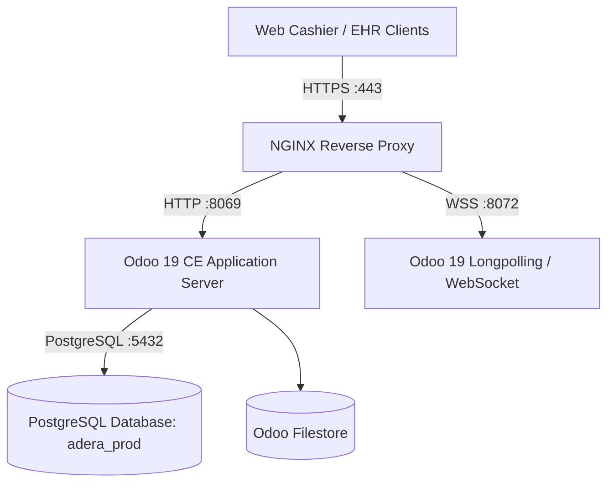

# KLINIK ADERA ERP (Odoo 19 CE) - OPERATIONAL RUNBOOK
**Document Version:** 1.0  
**Effective Date:** 2026-11-07  
**Entity:** PT Adera Medika Utama (Klinik Pratama & Klinik Utama Hemodialisis)

---

## 1. Production Architecture & Infrastructure Topology

### Module Landscape:
1. `adera_core`: Indonesian PSAK CoA, Clearing Control Accounts, Modern Analytic Hierarchy.
2. `adera_inventory`: Automated Anglo-Saxon Perpetual FIFO, Mandatory Lot/Expiry, FEFO removal, 3-Way Match AP.
3. `adera_pos`: Cashier Blind-Count, Multi-Tender Split (Co-Pay + BPJS claim), Voucher Deferred Revenue.
4. `adera_doctor_remuneration`: Encounter fee split accruals, Pasal 17 progressive PPh 21 engine (50% DPP).
5. `adera_clinic_bridge`: Inbound REST API, idempotent staging ledger, atomic auto-dispatch pipeline.

---

## 2. Month-End Financial Closing SOP (Step-by-Step Clinic Runbook)

### 2.1 GR/IR Clearing Audit (Account `211500`)
- **Objective:** Ensure all received pharmacy goods/consumables have corresponding vendor bills from distributors, leaving zero balance in clearing.
- **Protocol:**
  1. Go to **Accounting** $\rightarrow$ **Reporting** $\rightarrow$ **General Ledger**.
  2. Filter on Account `211500` (*Utang Belum Ditagih*).
  3. Filter by **Unreconciled Items**:
     - **Credit balances:** Goods received from PBF distributor without vendor bill. Contact distributor for billing invoice.
     - **Debit balances:** Vendor bills entered without linked Goods Receipt Note (GRN). Verify warehouse receiving slip.
  4. Perform matching using the reconciliation widget. Once 3-way match is complete, Account `211500` net balance must equal **Rp 0.00**.

---

### 2.2 Cashier Blind-Count & Drawer Audit (Account `619990`)
- **Objective:** Detect and audit cash variances across all cashier shifts.
- **Protocol:**
  1. Cashiers close shift via **Point of Sale** $\rightarrow$ **Close Session** using blind count (entering counted banknotes).
  2. Any variance between actual cash and system expected cash posts automatically:
     $$\text{Dr } 619990 \text{ (Beban Selisih Kas)} \quad / \quad \text{Cr } 111010 \text{ (Kas Kasir)}$$
  3. **Audit Threshold:**
     - Variances $< \text{Rp } 10.000$: Automatically written off as operational rounding variance.
     - Variances $\ge \text{Rp } 50.000$: Requires mandatory supervisor sign-off and Berita Acara Selisih Kasir before shift approval.

---

### 2.3 Doctor Remuneration Settlement & PPh 21 Filing Cycle
- **Objective:** Finalize doctor compensation, withhold PPh 21 Tenaga Ahli, and generate DJP e-Bupot exports.
- **Cut-Off Date:** 25th of every month.
- **Protocol:**
  1. Navigate to **Accounting** $\rightarrow$ **Remunerasi Dokter** $\rightarrow$ **Settlement & PPh 21**.
  2. Click **Create** $\rightarrow$ Select Doctor and Date Range (e.g., 26th previous month to 25th current month).
  3. Click **Tarik Jasa Medis (Load Accruals)**: Pulls all unbilled completed medical procedures.
  4. System calculates:
     $$\text{DPP} = 50\% \times \text{Gross Fee}$$
     $$\text{PPh 21} = \text{Tarif Progresif Pasal 17} \times \text{DPP}$$
     $$\text{Net Pay} = \text{Gross Fee} - \text{PPh 21}$$
  5. Click **Setujui Direksi** $\rightarrow$ Click **Posting Pembayaran & Potong PPh 21**.
  6. Journal Entry posted in `BBCA`:
     - Dr `213010`/`213020` (Utang Jasa Medis Dokter): Full Gross Fee
     - Cr `212030` (Utang PPh 21 Tenaga Ahli): PPh 21 Withheld
     - Cr `111110` (Bank BCA Operasional): Net Take-Home Pay
  7. Print **Bukti Potong PPh 21 & Slip Jasa Medis** (PDF) and provide to doctor. Export `212030` sub-ledger for filing via DJP e-Bupot Unifikasi by the 10th of the following month.

---

### 2.4 BPJS Claim Reconciliation & Dispute Management
- **Objective:** Reconcile open receivables in Account `112020` against BPJS VClaim disbursement notices (FOB / FPK).
- **Protocol:**
  1. Pull monthly FPK (*Formulir Pengajuan Klaim*) disbursement statement from BPJS VClaim.
  2. Go to **Accounting** $\rightarrow$ **Accounting** $\rightarrow$ **Reconciliation**.
  3. Reconcile received payment in Bank BCA against open receivables in `112020` matching by SEP Claim Number (`sep_claim_number`).
  4. **Disputed / Pending Verification Klaim:**
     - Flag claims pending dispute resolution in the BPJS staging ledger.
  5. **Legitimate Ineligible / Write-Off Claims:**
     - Post adjustment journal:
       $$\text{Dr } 112990 \text{ (Cadangan Kerugian Penurunan Nilai Piutang)} \quad / \quad \text{Cr } 112020 \text{ (Piutang Klaim BPJS)}$$

---

### 2.5 Periodic Stock Opname & Expiry Quarantine
- **Objective:** Enforce FEFO hygiene and prevent expired medicine or consumables from being dispensed.
- **Protocol:**
  1. Run weekly **Lot Expiry Report** in **Inventory** $\rightarrow$ **Lots/Serial Numbers**.
  2. Filter on `expiry_status` in (`critical`, `expired`).
  3. Any lot with $\le 30$ days shelf-life or expired must be moved immediately:
     - **Source:** `WH/Stock/Farmasi` or `WH/Stock/HD`
     - **Destination:** `WH/Quarantine` (`stock_location_pharma_quarantine`)
  4. System automatically flags `is_quarantined = True`, blocking selection in sales, POS, and outbound picking.
  5. For approved destruction / supplier returns: Post scrap movement to update perpetual inventory.

---

## 3. Day T Go-Live Execution Checklist (Cut-Over Timeline)

| Timeline | Phase | Responsible | Action Items |
| :--- | :--- | :--- | :--- |
| **T-7 Days** | Staging Dry-Run | DevOps & Lead Dev | Full end-to-end dry-run migration on staging database. Run `test_e2e_encounter.py` and verify all GL lines. |
| **T-3 Days** | Master Data Freeze | Clinic Controller | Freeze additions to Product master, Doctor contracts, and CoA definitions. Finalize doctor NPWP/SIP records. |
| **T-1 Day (21:00 WIB)** | EHR Sync Pause | IT Hospital Support | Temporarily pause outbound webhooks from EHR to avoid in-flight mismatch. |
| **T-1 Day (23:59 WIB)** | Legacy Ledger Cut-Off | Finance Controller | Close legacy accounting spreadsheets. Export final cut-off CSVs: `open_ap.csv`, `open_ar.csv`, `open_stock.csv`. |
| **Day T (00:01 - 02:00 WIB)** | Production DB Init | DevOps Engineer | Initialize `adera_prod` database, load module suite `adera_clinic_bridge`, verify journal sequences. |
| **Day T (02:00 - 04:30 WIB)** | Opening Balance Run | Lead Dev & Accounting | Execute `migrate_opening_balances.py` in Odoo shell. Verify suspense account `999999` nets to Rp 0.00. |
| **Day T (04:30 - 05:30 WIB)** | Hardware & POS Check | Cashier Supervisors | Verify POS terminals, receipt printers, and load initial cash drawer float into `KKSR` (Kas Kasir). |
| **Day T (05:30 - 06:30 WIB)** | Security & API Enable | DevOps & EHR Team | Activate production NGINX reverse proxy, configure SSL, update EHR webhook endpoint with production Bearer token. |
| **Day T (07:00 WIB)** | **CLINIC OPEN / GO-LIVE** | All Clinic Operations | First live patient encounter registered. Real-time monitoring of `/api/v1/clinic/encounter/sync` logs. |
| **Day T (14:00 WIB)** | Shift 1 Audit | Cashier & Finance Lead | First shift blind-count verification. Validate invoice generation and FEFO stock deduction in Odoo. |

---

## 4. Disaster Recovery & Rollback Plan

1. **Daily Backup:** Automated execution via `backup_odoo.bat` (database dump + filestore with 30-day rotation).
2. **Point-of-Failure Rollback:** If an unresolvable data corruption occurs before 06:00 WIB on Day T, revert DNS to legacy standby and resume operations under maintenance protocol.
3. **API Dead-Letter Recovery:** Any EHR webhook failing due to network outage is held in `clinic.encounter` with state `error`. The IT officer clicks **Proses Ulang Pipeline (Retry)** once network or master data is corrected.

